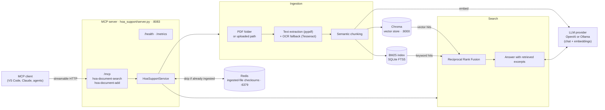

# AI HOA Support (Python)


It's an MCP server that answers HOA policy questions from your governing documents. On startup it loads PDF documents from a folder and processes them:

1. Extracts each page's text, with OCR fallback for scanned or image-based pages.
2. Splits the text into chunks by meaning (semantic chunking).
3. Embeds the chunks.
4. Indexes them in Chroma (vector search) and in a BM25 keyword index.

When an agent queries the server, it fuses the vector and keyword results with Reciprocal Rank Fusion (RRF) and sends the merged passages to an LLM to write the answer. Redis remembers which files have already been ingested, so they aren't processed twice.

## Architecture



## Java → Python mapping

| Java (Spring) | Python |
|---|---|
| `AiHoaSupportApplication` + `@McpTool` | `hoa_support/server.py` (official `mcp` SDK, streamable HTTP at `/mcp`) |
| `HoaSupportService` | `hoa_support/service.py` |
| `HoaDocumentLoader` (`@PostConstruct`) | `HoaSupportService.load_folder()`, called at startup |
| `SemanticDocumentSplitter` | `hoa_support/splitter.py` |
| `LucerneDocumentWriter` / `LucerneSearch` (Lucene BM25) | `hoa_support/bm25_index.py` (SQLite FTS5 BM25, built into Python) |
| Spring AI `ChromaVectorStore` | `hoa_support/vector_store.py` (`chromadb`) |
| `PdfOcrDetector` (PDFBox) + Tika/Tesseract OCR | `hoa_support/pdf_utils.py` (`pypdf`, `pdf2image`, `pytesseract`) |
| `AppConfig` model beans + `TokenUsageAdvisor` | `hoa_support/llm.py` |
| `RedisTemplate` | `RedisChecksumStore` in `service.py` |
| `application.yaml` | `hoa_support/config.py` + `.env` |
| Actuator / Prometheus | `GET /health`, `GET /metrics` |

## Setup

**System packages** (only needed for OCR):

```bash
# macOS
brew install tesseract poppler
# Ubuntu/Debian
sudo apt install tesseract-ocr poppler-utils
```

**Run it:**

```bash
python -m venv .venv && source .venv/bin/activate
pip install -e ".[dev]"            # or: pip install -r requirements.txt
cp .env.example .env               # add OPENAI_API_KEY, set HOA_DOCUMENT_FOLDER_PATH
docker compose up -d               # Chroma on :8000, Redis on :6379
python main.py                     # MCP endpoint: http://localhost:8083/mcp (same as: python -m hoa_support.server)
```

To ingest documents at startup, set `HOA_DOCUMENT_LOADING_ENABLED=true` and `HOA_DOCUMENT_FOLDER_PATH=/path/to/pdfs`. You can also add files at runtime with the `hoa-document-add` tool.

To use Ollama instead of OpenAI, set `LLM_PROVIDER=ollama` and `CHAT_MODEL_NAME=llama3.1` (or any model you've pulled).

## Chat UI

The server also hosts a browser chat page. Start the server and open **http://localhost:8083/**, then type a question. Answers come from the same hybrid search + LLM pipeline as `hoa-document-search`.

The page calls a small JSON endpoint that you can also use directly:

```bash
curl -X POST http://localhost:8083/api/chat -H "Content-Type: application/json"      -d '{"question": "How many pets can I keep?"}'
# {"answer": "..."}
```

The page lives in `hoa_support/static/index.html` (plain HTML/JS, no build step).

## MCP tools

| Tool | Input | What it does |
|---|---|---|
| `hoa-document-search` | `query` | Hybrid search, then an LLM answer grounded in the retrieved excerpts |
| `hoa-document-add` | `hoa_document_path` | Ingests a PDF from the server's filesystem; skips files it has already ingested |

**Connecting a client:** point it at `http://localhost:8083/mcp`. For example, in VS Code's `.vscode/mcp.json`:

```json
{ "servers": { "ai-hoa-support": { "type": "http", "url": "http://localhost:8083/mcp" } } }
```

`hoa.agent.md` is the agent definition, unchanged from the original.

## Tests

The tests use in-memory fakes, so they run without OpenAI, Chroma or Redis. The OCR test needs Tesseract installed.

```bash
pytest
```

## Changes from the Java version

- **Embeds each sentence once.** The semantic splitter embeds all sentences in a single batch. The Java version embedded every sentence twice, so this means fewer API calls with identical results.
- **New documents are searchable right away.** The Java `LucerneSearch` opened its index reader once at startup, so documents added later weren't keyword-searchable until a restart. FTS5 has no such limitation.
- **Failed files are retried.** A file's checksum is stored in Redis only after it's ingested successfully. The Java folder loader stored it first, so a file that failed was never retried.
- **Only PDFs are accepted.** `hoa-document-add` now rejects non-PDF paths. It can still read any PDF the server process can access, so restrict this in production.
- **Sensible default chat model.** The Java config defaulted the chat model name to an embedding model. Here it defaults to `gpt-4o-mini` (OpenAI) or `llama3.1` (Ollama).
"# HOA" 
